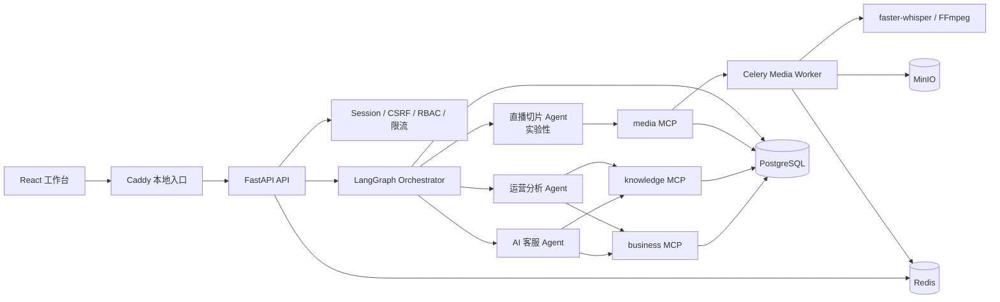

# 电商智能运营多 Agent 集群平台

**E-commerce Multi-Agent Operations Platform**：面向本地演示与工程验证的电商智能运营平台，以受控主控编排三个专业 Agent，并通过 MCP 工具、模拟业务数据、可追溯知识检索和媒体资产服务共享能力。

> 当前仅提供本地部署/本地演示模式，不提供公网实例。本仓库不会包含演示账号密码、真实 API Key、用户原始视频、模型权重或运行数据。

## 项目背景

电商客服、经营分析和直播素材处理通常分散在不同系统，容易出现上下文割裂、数据口径不一致、工具越权和结果不可追溯等问题。本项目将这些流程拆分为权限边界明确的专业 Agent，由 Orchestrator 生成结构化计划并汇总结果；业务数据、知识证据、工具审计和媒体任务则由共享服务统一承载。

项目重点不是让 Agent 任意互聊，而是验证一套可审计、可恢复、有限步骤、有限工具范围的多 Agent 协作方式。

## 当前状态

| 模块 | 状态 | 说明 |
| --- | --- | --- |
| 工程基础、模拟数据、MCP | 已实现 | FastAPI、React、PostgreSQL、Redis、内部 MCP 服务和迁移脚本 |
| AI 客服 Agent | 已实现 | 订单/物流/政策查询、退款资格、受控审批和人工接管 |
| 运营分析 Agent | 已实现 | 只读指标、趋势、确定性异常规则和证据引用 |
| 多 Agent 主控 | 已实现但有边界 | 结构化路由、最多三个子任务、部分成功、审批恢复和 SSE |
| 直播切片 Agent | 已实现 | 须人工审核 |
| 本地认证与安全 | 已实现 | Session、CSRF、RBAC、限流和安全审计 |
| 生产/公网部署 | 未启动 | 本次不启动生产 Compose、Cloudflare Tunnel 或任何公网入口 |

## 演示


架构、API、安全、评测和运行手册统一收录在[项目文档索引](docs/README.md)。

## 核心功能

- 统一工作台提交单 Agent 或复合任务，查看子任务、事件和汇总结果。
- LangGraph 状态图限制步骤数、跳数、超时和专业 Agent 工具白名单。
- PostgreSQL 持久化业务数据、运行状态、审批、审计和 checkpoint。
- SSE 提供运行事件续流；可恢复等待审批和部分成功状态。
- 服务端权限、店铺范围、证据引用、幂等键和提示注入防护。
- 本地 Session/CSRF/RBAC、Redis 限流和安全审计。
- 受控媒体上传、转写、候选生成、字幕/切片、QC 与人工复核。

## 三个专业 Agent

### AI 客服 Agent

负责订单与物流查询、当前政策检索、退款资格判断、模拟退款申请和转人工。读操作通过 business/knowledge MCP 完成；有副作用的退款申请需要审批，并以同一 thread 恢复。

### 运营分析 Agent

负责店铺指标、趋势和异常场景分析。指标来自只读 MCP 工具，异常检测使用确定性规则，输出携带可回溯的 `evidence_ref`，不允许执行任意 SQL。

### 直播切片 Agent

负责已授权媒体的上传、ASR、镜头/语义候选、评分、FFmpeg 渲染、字幕、QC 和人工复核。媒体 Worker 固定单并发。

该能力目前是 **EXPERIMENTAL / HUMAN_REVIEW_REQUIRED**：不能自动发布到任何真实媒体平台。

## 四类共享基础能力

1. **MCP 工具中台**：business、knowledge、media 三个内部 MCP 服务，提供工具注册、权限、审计、证据、审批和幂等约束。
2. **模拟业务数据服务**：固定 manifest 与 seed 生成订单、物流、库存、活动、政策等可重复数据，并通过 Alembic 管理结构。
3. **RAG 知识库服务**：基于 PostgreSQL 文档/分块的受控检索和证据回传，为客服回答提供检索增强基础。当前是关键词包含检索，不是向量数据库方案。
4. **媒体资产服务**：MinIO 对象存储、Celery 单并发 Worker、faster-whisper、FFmpeg、任务事件、QC 和人工审核。

## 多 Agent 工作流程

1. API 校验身份、店铺范围、输入和限流。
2. Orchestrator 生成受 Schema 约束的路由与子任务计划。
3. 主控按专业工具白名单调度客服、运营或媒体 Agent。
4. Agent 通过 MCP 获取模拟业务数据、知识证据或创建媒体任务。
5. 运行状态、事件、审批和 checkpoint 写入 PostgreSQL；异步状态通过 SSE 返回。
6. 主控校验子结果与证据，输出成功、部分成功、等待审批或人工接管。



## 技术栈

- 前端：React 19、TypeScript 5.8、Vite 7、Vitest、ESLint。
- 后端：Python 3.12、FastAPI、Pydantic、SQLAlchemy、Alembic、AsyncPG。
- Agent：LangGraph、LangChain Core、PostgreSQL checkpointer；DeepSeek 为可选 LLM，默认本地配置使用 fake provider。
- 工具协议：MCP Python SDK，Streamable HTTP 内部服务。
- 数据与任务：PostgreSQL 16、Redis 7、Celery 5、MinIO。
- 媒体：faster-whisper、FFmpeg/ffprobe，实验性 GPU Worker。
- 交付：Docker Compose、Caddy、Pytest、Ruff、Mypy。

项目当前未使用 Qdrant；不要把关键词知识检索误认为已经完成的向量 RAG。

## 目录结构

```text
.
├── backend/
│   ├── app/                 # API、Agent、媒体、安全、数据模型
│   ├── mcp_servers/         # business / knowledge / media MCP
│   └── scripts/             # 数据和受控验收脚本
├── frontend/                # React 工作台、运营与媒体页面
├── migrations/              # Alembic 迁移
├── data/manifests/          # 脱敏的确定性模拟数据清单
├── deploy/                  # Caddy、镜像、备份与安全 runbook
├── docs/                    # 架构、契约和运行说明
├── evals/                   # 评测用例与执行器（生成结果不入库）
├── tests/                   # 后端、Agent、媒体与安全测试
├── scripts/                 # Compose、安全和评测辅助脚本
├── compose.yaml
├── compose.dev.yaml
├── compose.prod.yaml        # 仅作配置/安全检查，勿直接启动
└── .env.example
```

## 环境要求

- Ubuntu 或其他支持 Docker 的 Linux 环境。
- Docker Engine 与 Docker Compose v2。
- 本机运行质量检查时需要 Python 3.12+、Node.js 22+ 和 npm。
- `DATA_ROOT` 必须指向外部数据盘上的项目专用目录，并预先准备 PostgreSQL、Redis、MinIO、临时文件和模型子目录所需权限。
- 只有启用实验性媒体 Worker 时才需要 FFmpeg、兼容的 NVIDIA 环境和已明确分配的一张 GPU；默认媒体并发为 1。

## 配置

```bash
cp .env.example .env
chmod 600 .env
```

编辑 `.env`，至少完成以下事项：

- 把所有 `CHANGE_ME`、`YOUR_*_HERE` 替换为本地值。
- 为 PostgreSQL、Redis 和 MinIO 分别设置非默认密码。
- 将 `DATA_ROOT` 指向外部数据盘的专用目录。
- 保持 `AGENT_LLM_MODE=fake` 可在无 API Key 时本地演示；使用 DeepSeek 时仅把 Key 写入未跟踪的 `.env`。
- 不启用媒体能力时保持 `MEDIA_ENABLED=false`。
- 仅在 GPU 已明确分配后填写 `MEDIA_GPU_DEVICE_ID`。

`.env.example` 只包含占位符和非敏感默认值；不要提交 `.env` 或 `secrets/`。

## 本地启动

以下命令启动本地开发栈和阶段 4 MCP 能力，不启动生产配置或 Tunnel：

```bash
docker compose \
  -f compose.yaml -f compose.dev.yaml \
  --profile stage4 config --quiet

docker compose \
  -f compose.yaml -f compose.dev.yaml \
  --profile stage4 up -d --build

docker compose \
  -f compose.yaml -f compose.dev.yaml \
  --profile stage4 exec -T business-mcp alembic upgrade head

docker compose \
  -f compose.yaml -f compose.dev.yaml \
  --profile stage4 exec -T business-mcp \
  python -m app.seed.cli seed \
  --manifest /app/data/manifests/stage2_base_v1.json
```

本地入口：

- 工作台：<http://localhost:8080/workbench>
- 运营页：<http://localhost:8080/operations>
- 媒体页：<http://localhost:8080/media>
- API 健康检查：<http://localhost:8000/api/v1/health/live>
- 开发 OpenAPI：<http://localhost:8000/docs>

如需本地管理员登录，可在 API 容器中交互执行 `python /app/scripts/bootstrap_admin.py`。脚本通过隐藏输入读取密码，不接受把密码放在命令行参数中。

实验性直播切片需要额外准备离线 ASR 模型、MinIO 目录和明确分配的 GPU，然后才可把 profile 改为 `stage5`；这不是默认启动路径。

## Compose 运维

查看状态与日志：

```bash
docker compose -f compose.yaml -f compose.dev.yaml --profile stage4 ps
docker compose -f compose.yaml -f compose.dev.yaml --profile stage4 logs -f --tail=100
```

停止本地栈：

```bash
docker compose -f compose.yaml -f compose.dev.yaml --profile stage4 down
```

不要添加 `-v`，以免删除本地状态。`compose.prod.yaml` 与 `compose.public.yaml` 当前只用于静态配置和安全验证。

## 测试与验证

```bash
.venv/bin/ruff format --check backend tests scripts deploy/runbooks
.venv/bin/ruff check backend tests scripts deploy/runbooks
.venv/bin/mypy
.venv/bin/pytest -m "not live_llm and not container_acceptance"

npm --prefix frontend run lint
npm --prefix frontend run test
npm --prefix frontend run build

.venv/bin/python scripts/check_stage5_compose_security.py compose.dev.yaml
.venv/bin/python scripts/check_stage5_compose_security.py compose.prod.yaml
.venv/bin/python deploy/runbooks/scan_secrets.py
git diff --check
```

`live_llm` 与容器验收用例默认不会运行；它们需要显式配置外部模型或容器环境。


